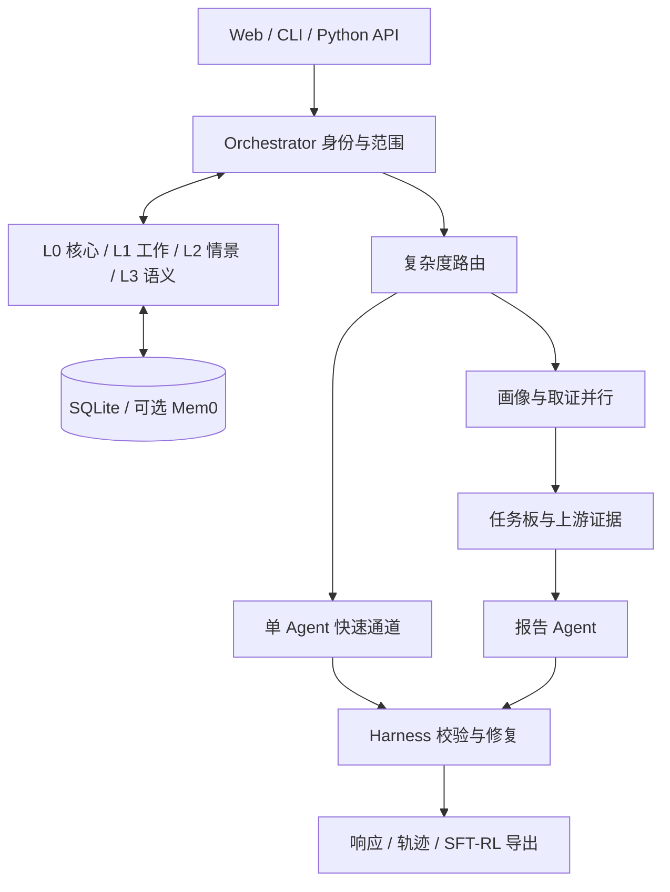

# 审知 · 智能审计工作台 Agent Harness

基于 Python 3.10+ 标准库的可运行项目：中文 Web 工作台、HTTP API、7 个独立 Skill、3 个专业 Agent、ReAct 执行、Swarm 协作、四层持久化记忆、YAML 约束和 SFT/RL 轨迹导出。默认本地规则模式使用合成审计数据，无第三方运行依赖，无密钥也可运行。

## 启动

在项目目录运行：

```powershell
# 自动选择 Python 或本机 Codex 配套 Python
powershell -ExecutionPolicy Bypass -File .\scripts\run.ps1
```

打开 <http://127.0.0.1:8018>。工作台提供企业选择、多轮对话、证据来源、任务依赖、四层记忆和训练轨迹下载。刷新会恢复会话及最新执行结果。

通用 Python 入口：

```bash
python -m audit_assistant --serve --port 8018
python -m audit_assistant --query "综合分析华东供应商近三年企业画像、疑点取证并生成报告"
python -m audit_assistant --query "那应该补充哪些证据？" --session cli
python -m audit_assistant --query "每年的付款合计是多少？" --entity C001 --json --output artifacts/answer.json
```

默认创建 `data/audit.sqlite3`，保存合成业务记录、对话、案例摘要、规则及轨迹，已加入 `.gitignore`。用 `--db` 或 `db_path` 可指定其他数据库。

## 演示场景

选择“华东供应商”，查询企业画像，然后选择全流程协作与报告。画像与取证并行运行，报告等待上游任务完成后汇总。演示企业有 5 笔付款，合计 **2,770,000 元**，可定位同日 48 万/49 万付款、重复发票 `INV004`、逾期及合同 `HT002` 期间超付，并引用交易编号。追问会继承企业和期间；同一人员的新会话可检索既往案例。

企业、台账、风险阈值和指南均为合成演示材料，不能作为真实审计结论或正式法规。

## 能力与实现

| 能力 | 实现 |
|---|---|
| Skill / Agent 解耦 | `SkillRegistry` 可独立注册与运行，Agent 仅依赖注册表和 YAML 能力列表 |
| 7 个 Skill | 深度搜索、信息聚合、风险评估、审计建议、Text2SQL、审计指南、深度研究 |
| 3 个 Agent | 企业画像、疑点取证、报告生成，各自有任务目标和能力边界 |
| ReAct | 每轮根据已有观察选择工具或结束，记录公开决策摘要、参数、观察、来源和耗时；不保存私密思维链 |
| 调用硬限制 | 每 Agent 最多 3 次 Skill 调用，失败/越界尝试也计数；Swarm 最多 9 次 |
| 时间控制 | 单 Agent 15 秒预算，远端请求限制超时，预算耗尽停止新增调用，返回部分结果 |
| 1.0 双层记忆 | `memory_version=1` 向规划器注入 L1/L2，身份权限验证始终保留 |
| 2.0 四层记忆 | L0 身份权限偏好、L1 会话、L2 跨会话案例、L3 审计规则与候选实践 |
| 熵压缩 | 去重、句子信息熵、数字和风险词评分；目标 35%，完整保留最近问题，记录实际压缩率 |
| Swarm | 按目标复杂度路由，独立任务线程并行，任务板记录状态与依赖，报告注入上游证据 |
| Harness | 启动读取 `config/harness.yaml`，执行前校验能力边界，输出修复风险标记、缺证据提醒及无效引用 |
| 后训练数据 | 持久化轨迹，SFT function/tool 消息，RL 规则奖励，保留 local/llm 执行模式 |



Agent Loop 使用可注入的 `LocalPlanner` 或 `OpenAICompatiblePlanner`。最终报告采用证据确定性渲染，事实和金额直接来自 Skill 输出；模型负责工具决策，避免将无来源自由文本作为审计结论。Skill 不调用专业 Agent，也不隐藏嵌套 Agent 循环。

## 四层记忆

- **L0**：服务端 `UserIdentity` 包含身份、角色、权限、企业授权及偏好，会话绑定人员。权限或角色变化要求新会话，避免旧上下文泄露。
- **L1**：SQLite 持久化用户与助手对话，以用户轮次加载最近五轮。记忆实例和锁按数据库、人员、会话共享，工具轨迹不占对话轮次。
- **L2**：本地中文二字词稀疏向量余弦检索，按人员及企业权限过滤。配置 Mem0 后额外云端检索与写入；异常时回退本地并提示。
- **L3**：预置审计原则；同一风险模式在至少两个请求、两个不同交易证据集合中出现后归纳为候选规则，保留来源。重复查询同一批交易不会虚增独立案例数。这是证据支持的规则归纳原型，不是自动发布行业准则。

## 接入模型与 Mem0

配置示例见 `.env.example`。项目不会自动加载 `.env`，需用 shell 或部署平台设置：

```powershell
$env:AUDIT_MODE = 'llm'
$env:AUDIT_LLM_BASE_URL = 'https://你的兼容服务/v1'
$env:AUDIT_LLM_MODEL = '支持工具调用的模型名'
$env:AUDIT_LLM_API_KEY = '本机设置密钥'
# 可选：问题和案例摘要将发送给配置的 Mem0 服务
$env:MEM0_API_KEY = '本机设置密钥'
powershell -ExecutionPolicy Bypass -File .\scripts\run.ps1
```

模型适配器使用 `POST /chat/completions`、function tools、单轮单工具及工具观察消息。不同厂商对 `temperature`、`max_tokens`、`parallel_tool_calls` 支持可能不同，应选兼容服务或调整适配器。Mem0 使用 `/v1/memories/` 写入与 `/v2/memories/search/` 检索，以人员和数据库派生的命名空间隔离。

外部适配器通过协议模拟测试，**交付时未使用真实密钥做云端端到端验证**。离线轨迹用于调试和基线样本，不等同真实模型推理或人工标注轨迹。

## Python API 与扩展

```python
from audit_assistant import AuditAssistant, UserIdentity

identity = UserIdentity(
    user_id="auditor-001", entity_ids=["C001"],
    preferences={"report_style": "简洁", "focus": "关联交易"},
)
assistant = AuditAssistant("case-001", identity=identity, db_path="data/audit.sqlite3")
result = assistant.ask("近三年的疑点取证", entity="C001")
print(result.answer)
print(result.to_dict()["trace"])
```

`planner`、`registry`、`harness_path`、`db_path` 均可注入。数据连接器入口为 `SkillContext.read` / `AuditStore.read`。连接企业平台时替换访问层，并保留行级权限和证据来源。

Text2SQL 当前支持汇总、按年、明细三类参数化 SQLite 模板，由意图或模型参数选择并实际执行，不接受任意模型 SQL。SQLite authorizer、授权临时视图、单 SELECT 校验与查询进度超时共同约束业务查询；模型不能读取会话/记忆表或绕过企业权限。

## HTTP API

| 方法 | 路径 | 用途 |
|---|---|---|
| GET | `/api/health` | 健康状态与执行模式 |
| GET | `/api/config` | 当前身份与授权企业 |
| POST | `/api/sessions` | 创建会话，请求体 `{}` |
| POST | `/api/chat` | `session_id`、`query`、可选 `entity` / `since` / `until` |
| GET | `/api/memory?session_id=...` | 四层记忆及最新响应 |
| GET | `/api/reports/{request_id}` | Markdown 审计底稿 |
| GET | `/api/export?format=sft` | `sft` / `rl` / `raw` JSONL |

默认只监听回环地址，对外监听强制要求 `AUDIT_API_TOKEN`，访问时提供 `Authorization: Bearer ...`。页面令牌只保留在当前页内存，模型密钥留在后端。`AUDIT_USER_ID` / `AUDIT_ENTITY_IDS` 设置演示身份；当前一个服务实例对应一个可信身份，生产部署需另接 SSO/IAM、TLS 和身份映射。

## 训练轨迹

```bash
python -m audit_assistant --export sft --output artifacts/sft.jsonl
python -m audit_assistant --export rl --output artifacts/rl.jsonl
python -m audit_assistant --export raw --output artifacts/trajectories.jsonl
```

SFT 仅导出通过证据引用、调用预算、工具成功、任务完成和风险/缺证据披露检查的记录。RL 奖励为可解释规则信号的平均值，保留失败样本。没有合成人工偏好，也没有在此仓库实际训练或宣称 SFT/RL 收益。导出基础脱敏企业名、手机号、邮箱、常见 API 令牌并散列会话标识；真实数据进入训练前仍需人工审查。

`Evidence.confidence=1.0` 表示直接从来源构造，并非真实性概率；Agent 当前不进行概率估计。质量分衡量工程约束，不代表审计正确率。

## 验证与评测

```powershell
powershell -ExecutionPolicy Bypass -File .\scripts\run.ps1 -Mode test
powershell -ExecutionPolicy Bypass -File .\scripts\run.ps1 -Mode eval
```

```bash
python -m unittest discover -s tests -v
python -m audit_assistant.evaluate --output artifacts/evaluation.json
python -m audit_assistant.evaluate --memory-version 1 --output artifacts/evaluation-v1.json
```

测试覆盖金额计算、风险识别、动态调用、越界预算、超时停止、YAML、SQL/企业授权、人员会话隔离、持久记忆、SFT 过滤、模型/Mem0 协议与 HTTP 全流程。CI 配置覆盖 Python 3.10/3.12，本地实际测试使用 Python 3.12。

`evals/cases.json` 刻意由 7 个单 Agent 和 3 个 Swarm 样本组成，报告实际路由、预期风险覆盖及延迟。**70%/30% 是样本构成，不能当作线上流量结论**。35% 是压缩目标；15 秒是单 Agent 时间预算。网络缓慢或不可中断的自定义 Skill 仍可能超时，Swarm 依赖也会增加整体耗时。没有生产数据和真实模型基准时，不能把这些目标写成已证实的线上成果。

## 文件结构

```text
audit_assistant/
  agents.py          # Agent 与受限循环
  skills.py          # 7 个 Skill 与注册表
  llm.py             # 规则策略与模型工具调用
  swarm.py           # 路由、并行任务、任务板
  memory.py          # 四层记忆、压缩与 Mem0
  harness.py         # YAML、能力约束、自动修复
  storage.py         # SQLite 与权限
  orchestrator.py    # 对话和查询范围
  trajectories.py   # 质量信号、脱敏与导出
  server.py          # HTTP API
  evaluate.py        # 评测
  web/               # 无构建步骤的中文工作台
config/harness.yaml
evals/cases.json
tests/
scripts/run.ps1
```

